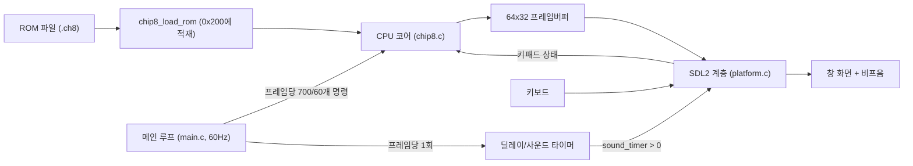
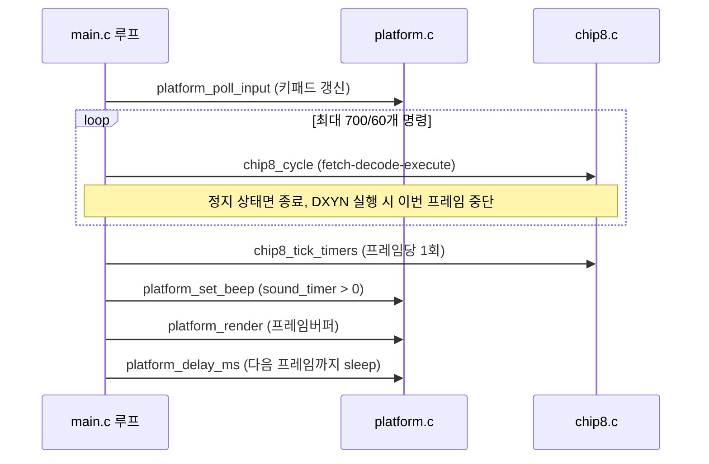
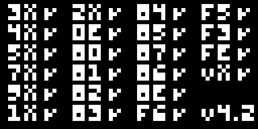
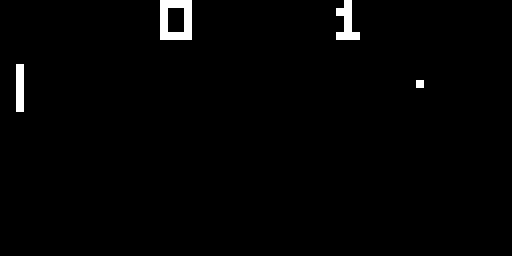

# CHIP-8 에뮬레이터

가상 머신 CHIP-8용 게임 롬(ROM, 프로그램 파일)을 그대로 돌리는 에뮬레이터. C + SDL2로 작성.

## 왜 만들었나

- CHIP-8은 명령어(옵코드) 35개짜리 단순한 가상 CPU다. 명세가 전부 공개되어 있고 돌려볼 게임 롬도 많다.
- 직접 CPU를 흉내 내면서 fetch-decode-execute 사이클(명령을 읽고, 해석하고, 실행하는 반복), 레지스터, 메모리맵, 타이머를 손으로 익히는 것이 목적이다.
- 기존 프로젝트(visual-disk는 디스크, cub3d/miniRT는 그래픽)에 없던 CPU 층을 채우고, xv6 커널 트랙 전에 "기계 밑바닥" 감각을 잡기 위한 학습용 토이다.

## 주요 기능

- 원조 COSMAC VIP CHIP-8 옵코드 35개 구현
- 메모리 4KB, 레지스터 V0~VF, I, PC, 스택 16레벨, 딜레이/사운드 타이머
- 64x32 흑백 화면을 SDL2 창에 10배 확대(640x320)해서 표시
- 16키 키패드 입력, 사운드 타이머 동안 440Hz 비프음
- CPU 700 IPS(초당 명령 수), 타이머 60Hz - 두 속도는 서로 독립인 상수
- VIP quirk(구현마다 다른 세부 동작) 6종을 `chip8.h`의 컴파일 타임 상수로 분리
- 명시적 에러 처리: 롬 파일 없음/크기 초과(3584바이트), 스택 오버/언더플로, 미지 옵코드는 PC를 출력하고 정지
- 창 없이 실행하는 헤드리스 검증 훅(환경 변수로만 켜짐)

## 동작 구조



- `chip8.c` - 순수 에뮬레이션 계층. 메모리, 레지스터, 옵코드 실행, 프레임버퍼. SDL을 전혀 호출하지 않는다.
- `platform.c` - SDL2를 쓰는 유일한 곳. 프레임버퍼를 읽어 그리고, 키 입력을 키패드 배열에 쓰고, 비프음을 낸다.
- `main.c` - 60Hz 프레임 루프. 매 프레임 명령을 700/60개 실행하고 타이머를 1 감소시킨 뒤 sleep으로 다음 프레임까지 기다린다(busy-spin 없음). VIP display-wait quirk에 따라 화면 그리기(DXYN)는 프레임당 1회만 실행된다.

메인 루프 한 프레임:



## 검증 결과

판정 기준은 Timendus chip8-test-suite 테스트 롬 + Pong + Tetris. 상세 수용 기준은 [`.planning/SPEC.md`](.planning/SPEC.md).

| 항목 | 결과 | 근거 |
|---|---|---|
| 3-corax+ (옵코드) | 통과 (전 항목 체크) | `snapshots/3-corax+.png` |
| 4-flags (VF 플래그) | 통과 (전 항목 체크) | `snapshots/4-flags.png` |
| 5-quirks (VIP quirk) | 통과 (6개 항목 체크) | `snapshots/5-quirks.png` |
| 6-keypad (EX9E/EXA1/FX0A) | 3종 통과, FX0A는 키 릴리스 시점에 등록 | `snapshots/6-keypad-*.png` |
| 7-beep | 화면 표시와 sound_timer 프레임 단위 동기, SDL 오디오 출력 캡처에서 440Hz(측정 438~441) 정사각파 | SPEC R6 |
| Pong | 헤드리스 3600프레임(60초분) 무크래시, 키 입력 시 패들 위치·스코어 분기 | `snapshots/pong-keyresponse.png` |
| Tetris | 헤드리스 3600프레임(60초분) 무크래시, 키 4 입력 시 같은 프레임에 피스 이동 | `snapshots/tetris-keyresponse.png` |

아직 실제 창에서만 확인 가능한 항목: ESC 종료, 스피커로 듣는 가청 여부, 실시간 플레이감.

## 스크린샷

Timendus 3-corax+ 옵코드 테스트 (전 항목 체크):



Pong, Tetris 구동:




## 빠른 시작

요구 사항: macOS + clang + Homebrew SDL2 (빌드 시 `pkg-config`로 찾음). 다른 OS는 검증하지 않았다.

```sh
brew install sdl2 pkg-config
make
./chip8 roms/pong.ch8
```

- 롬 파일은 저장소에 포함되지 않는다(`roms/`는 `.gitignore` 대상). 테스트 롬은 [Timendus/chip8-test-suite](https://github.com/Timendus/chip8-test-suite)의 `bin/`에서 받아 `roms/`에 둔다. Pong/Tetris는 퍼블릭 도메인 CHIP-8 롬 아카이브에서 구한다.
- 인자 없이 실행하면 `usage: ./chip8 <rom>`을 출력하고 종료한다.
- `make clean`으로 빌드 산출물 삭제.

### 키 매핑

COSMAC 16진 키패드를 QWERTY 왼쪽 4x4 블록에 매핑. ESC로 종료.

| 키보드 | | | | | CHIP-8 | | | |
|---|---|---|---|---|---|---|---|---|
| `1` | `2` | `3` | `4` | | 1 | 2 | 3 | C |
| `Q` | `W` | `E` | `R` | | 4 | 5 | 6 | D |
| `A` | `S` | `D` | `F` | | 7 | 8 | 9 | E |
| `Z` | `X` | `C` | `V` | | A | 0 | B | F |

## 헤드리스 검증 훅

별도 테스트 프레임워크는 없고, 테스트 롬을 창 없이 돌려 화면을 파일로 떨구는 방식으로 검증한다. 모두 환경 변수로만 켜지며, 설정하지 않으면 동작이 바뀌지 않는다.

| 환경 변수 | 동작 |
|---|---|
| `CHIP8_DUMP=<path.bmp>` | 창 없이 실행 후 프레임버퍼를 BMP(512x256)로 저장 |
| `CHIP8_DUMP_CYCLES=<n>` | 저장 전 실행할 명령 수 (기본 600000) |
| `CHIP8_DUMP_KEY=<hex>` | 한 키를 초반에 누르고 있다가 뗌 (메뉴 진입용) |
| `CHIP8_DUMP_KEYSEQ="F:K:d,F:K:u,..."` | 프레임 F에 키 K(hex)를 누름(d)/뗌(u). 최대 64개 |
| `CHIP8_DUMP_EVERY=<n>` | n프레임마다 `<path>.f<frame>.bmp` 추가 저장 |
| `CHIP8_BEEP_LOG=<file>` | 프레임별 `frame sound_timer 점등픽셀수` 기록 |
| `CHIP8_SEED=<n>` | CXNN 난수 시드 고정 (같은 조건 재현용) |

예시:

```sh
# corax+ 결과 화면을 BMP로 저장
CHIP8_DUMP=out.bmp ./chip8 roms/3-corax+.ch8

# 실제 SDL 오디오 출력을 파일로 캡처 (S16 mono 44.1kHz)
SDL_VIDEODRIVER=dummy SDL_AUDIODRIVER=disk SDL_DISKAUDIOFILE=out.raw ./chip8 roms/7-beep.ch8
```

타이머 주기 측정용 로그 빌드: `make CFLAGS_EXTRA=-DCHIP8_TIMER_LOG` (종료 시 타이머 감소 횟수와 Hz 출력).

## 프로젝트 구조

```
chip8-emulator/
├── chip8.c / chip8.h       # CPU 코어, 옵코드, quirk 상수 (SDL 없음)
├── platform.c / platform.h # SDL2 창, 입력, 비프음, BMP 덤프
├── main.c                  # CLI, 60Hz 메인 루프, 헤드리스 훅
├── Makefile
├── snapshots/              # 검증 스냅샷 PNG
├── roms/                   # 롬 파일 (git 제외, 직접 받아서 배치)
└── .planning/              # SPEC과 단계별 plan
```

## 문서

- [`docs/SRS.md`](docs/SRS.md) - 요구사항 명세 (ISO/IEC/IEEE 29148)
- [`docs/SDS.md`](docs/SDS.md) - 설계 명세: 구성도, 시퀀스, 자료구조, 상태, 모듈 (IEEE 1016)
- [`docs/adr/`](docs/adr/README.md) - 설계 결정 기록
- [`CHANGELOG.md`](CHANGELOG.md) - 변경 이력
- [`.planning/SPEC.md`](.planning/SPEC.md) - 요구사항, 수용 기준, 범위 밖 항목과 이유
- [`.planning/plans/`](.planning/plans/) - 구현 단계별 plan 4개

## 다음 확장 (선택)

재미 붙으면 Game Boy 에뮬레이터가 정석 다음 단계. 또는 바이트코드 VM(토이 7번)과 개념 연결 - 둘 다 "가상 머신". SUPER-CHIP / XO-CHIP 확장은 현재 범위 밖.
