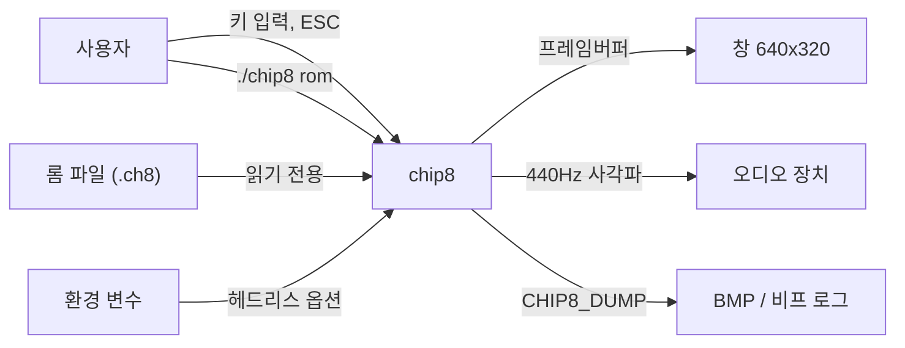
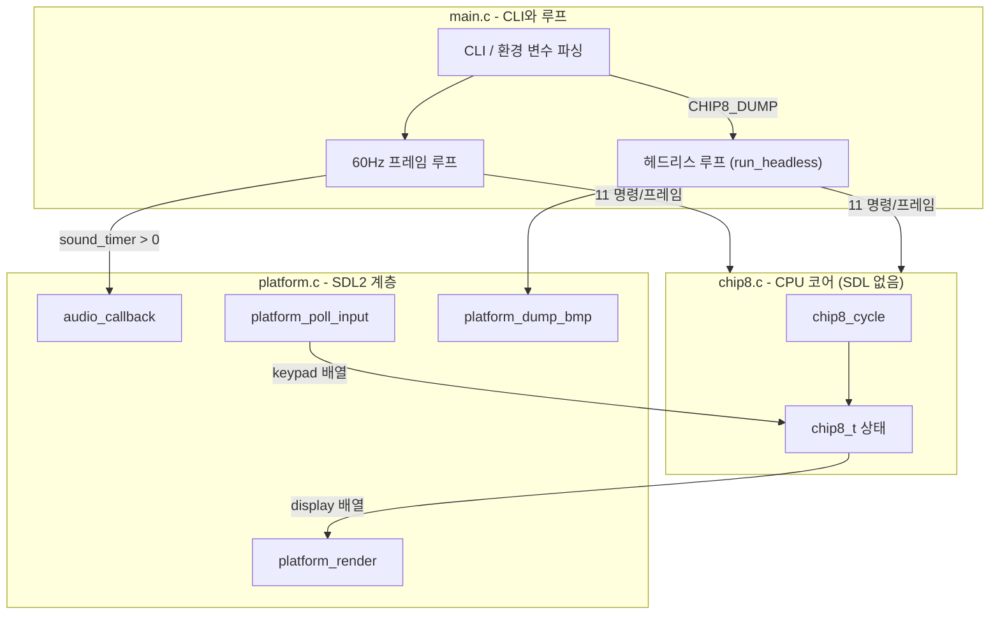
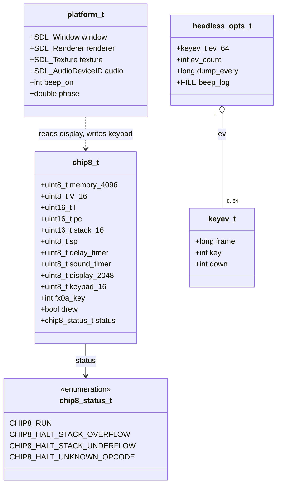
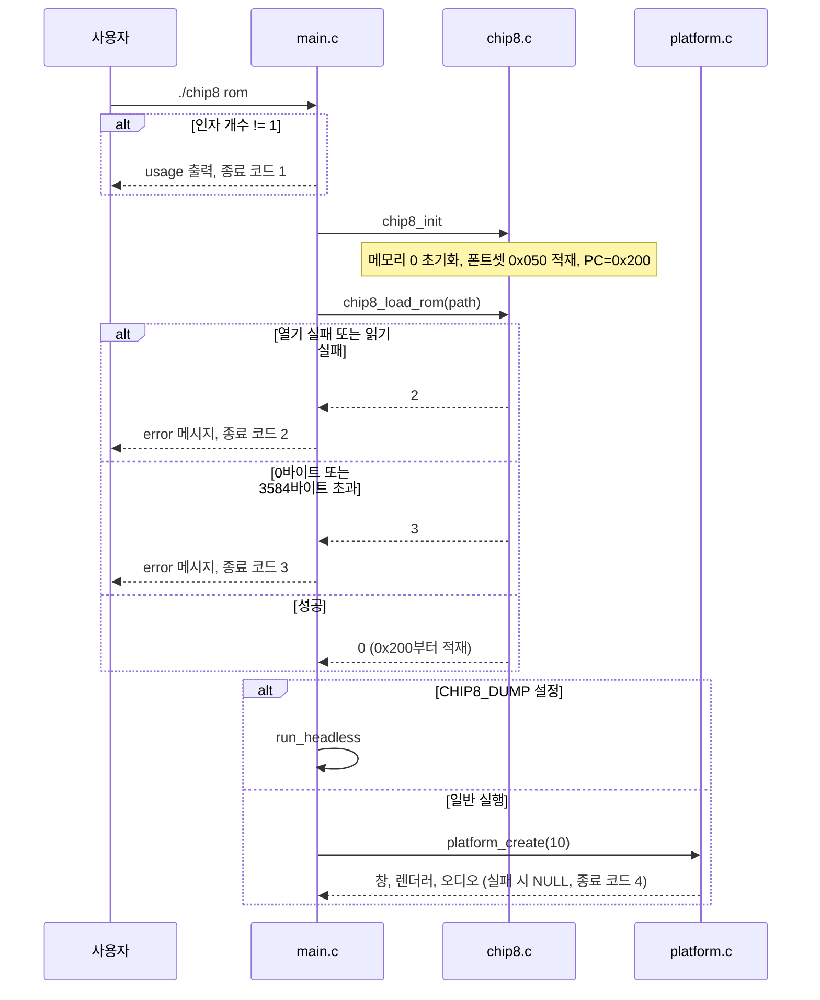
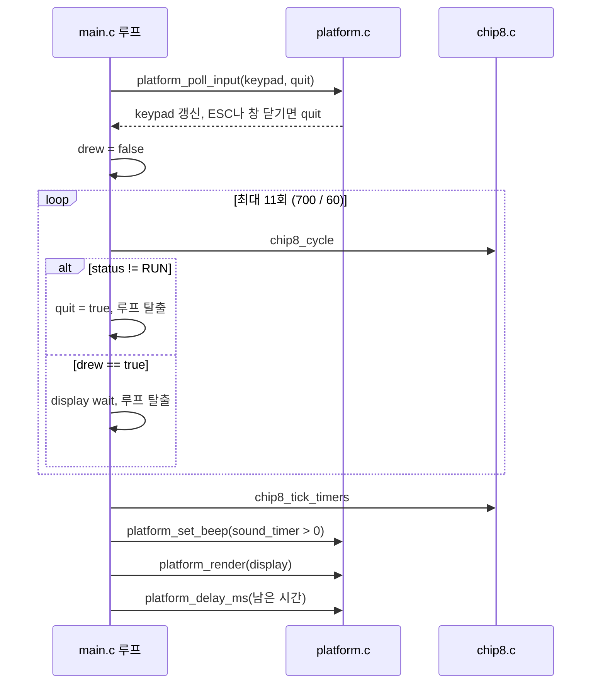
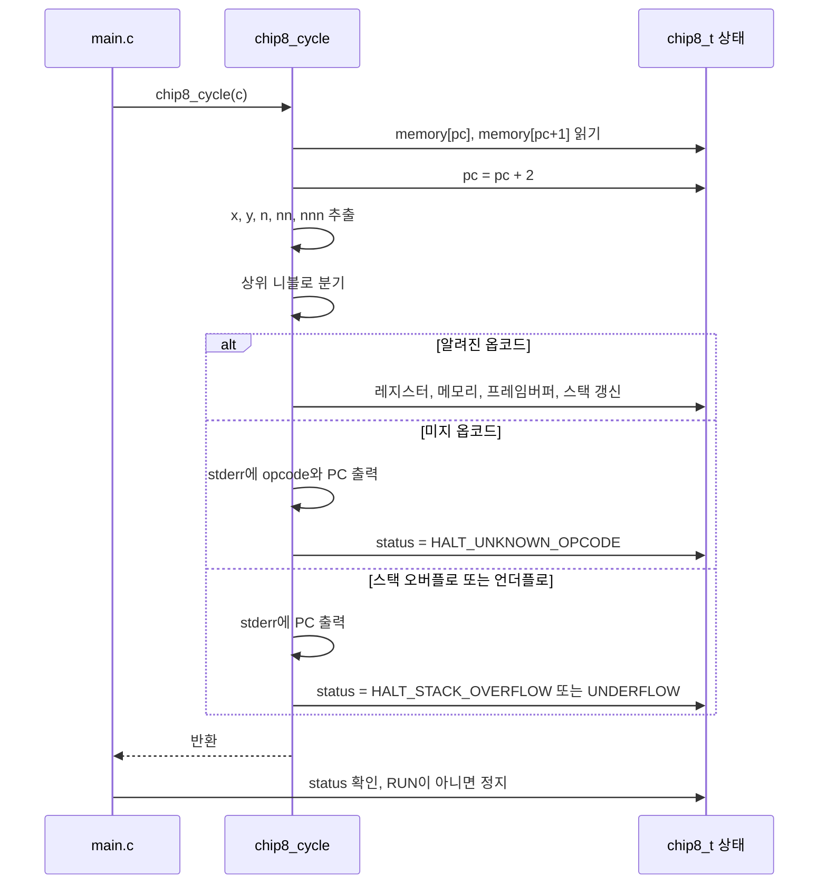
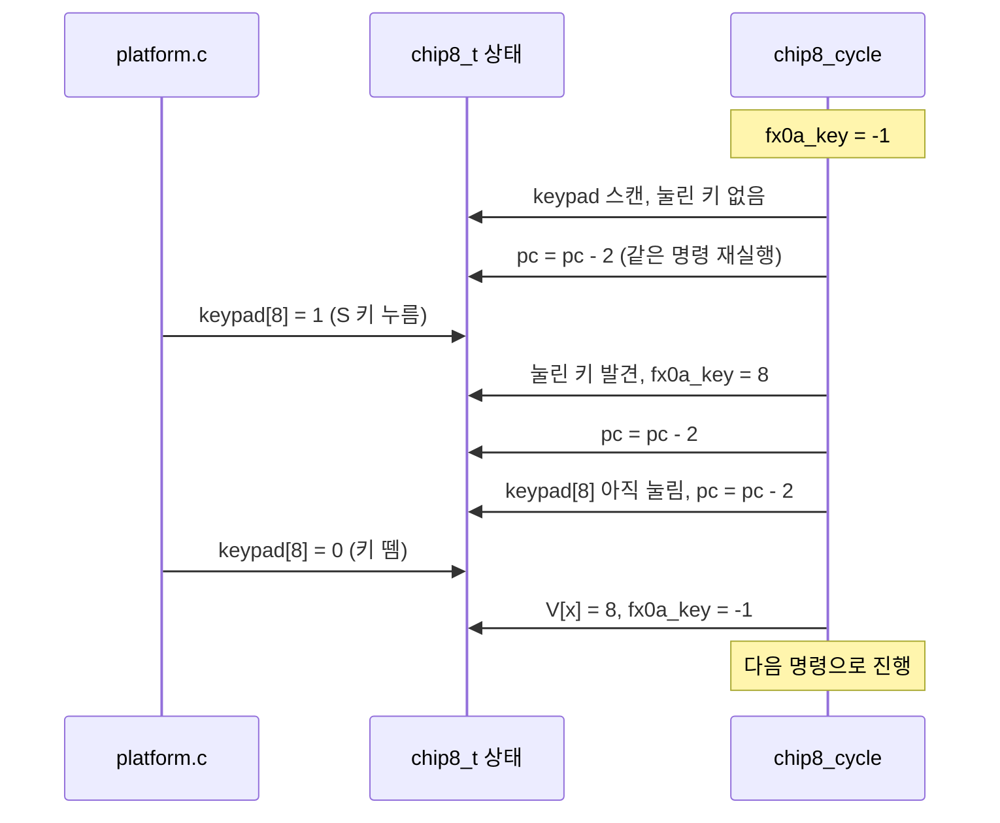
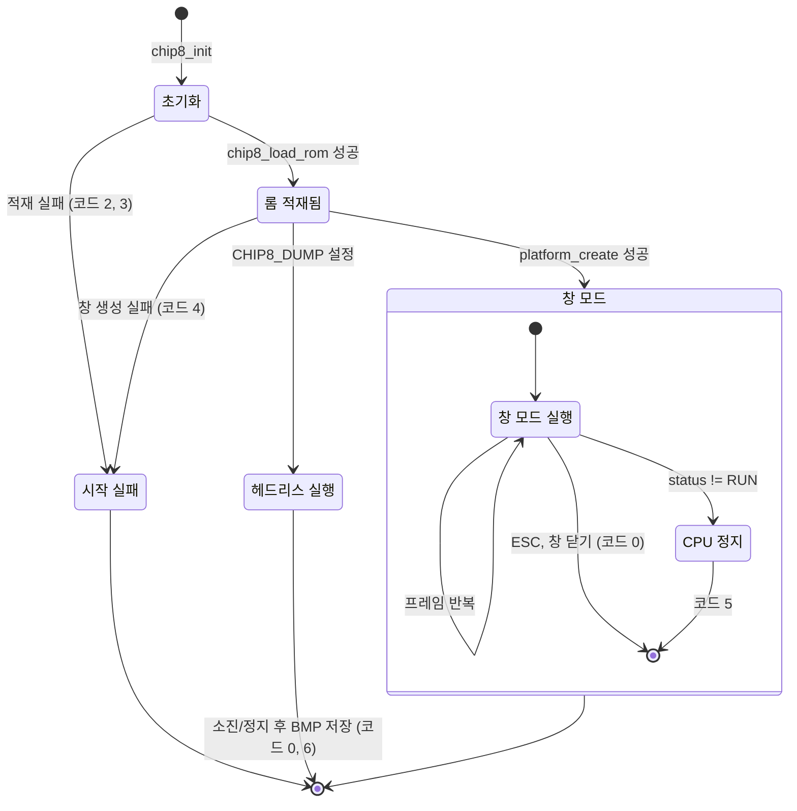
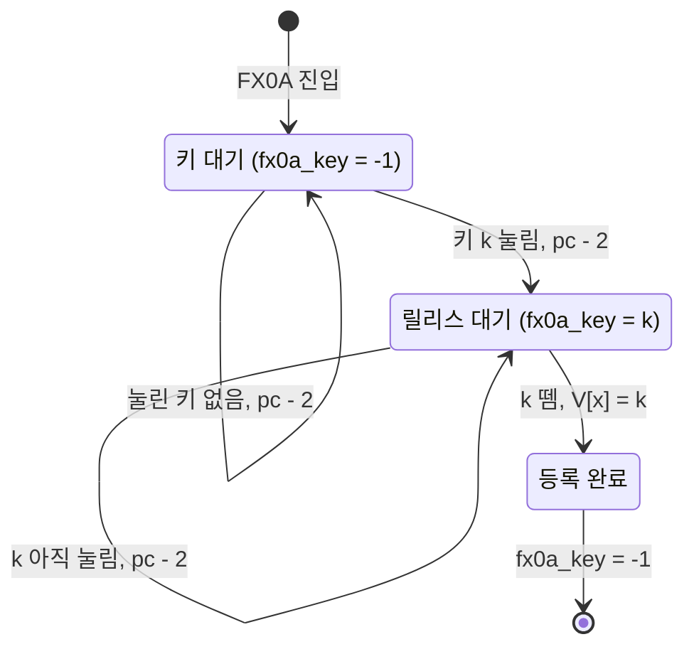

# CHIP-8 에뮬레이터 소프트웨어 설계 명세서 (SDS)

| 문서 | 버전 | 작성일 | 기준 표준 |
|---|---|---|---|
| CHIP-8 에뮬레이터 SDS | 1.0 | 2026-11-18 | IEEE 1016-2009 |

## 1. 소개

### 1.1 목적

이 문서는 CHIP-8 에뮬레이터가 [SRS](SRS.md)의 요구사항을 어떤 구조로 만족하는지 설명한다. 코드를 처음 보는 개발자가 파일 3개(`chip8.c`, `platform.c`, `main.c`)의 역할, 핵심 자료구조, 실행 흐름을 이 문서만으로 파악하는 것이 목적이다.

### 1.2 범위

C11 + SDL2로 작성한 원조 COSMAC VIP CHIP-8 에뮬레이터 전체를 다룬다. 순수 에뮬레이션 계층(`chip8.c`)과 SDL2 입출력 계층(`platform.c`)을 분리하고, `main.c`가 60Hz 프레임 루프로 둘을 연결한다. 헤드리스 검증 모드도 포함한다.

### 1.3 용어 정의

[SRS 1.4 용어 정의](SRS.md#14-용어-정의)를 따른다.

### 1.4 참고 문서

| 문서 | 위치 |
|---|---|
| 요구사항 명세서 (SRS) | [SRS.md](SRS.md) |
| README | [../README.md](../README.md) |
| 프로젝트 SPEC | [../.planning/SPEC.md](../.planning/SPEC.md) |
| 헤더 파일 | [../chip8.h](../chip8.h), [../platform.h](../platform.h) |

## 2. 설계 이해관계자와 관심사

| 이해관계자 | 관심사 | 다루는 뷰 |
|---|---|---|
| 학습자 / 개발자 | CPU 상태, 메모리맵, fetch-decode-execute가 코드로 어떻게 표현되는가 | 3.3 논리, 3.4 정보, 3.6 상호작용, 3.8 알고리즘 |
| 유지보수자 | 계층 분리, quirk 변경 지점, 모듈 책임 | 3.2 구성, 3.3 논리, 4 설계 근거 |
| 검증자 | 헤드리스 훅 사용법, 종료 코드, 출력 파일 형식 | 3.4 정보, 3.5 인터페이스, 5 오류 처리 |
| 플레이어 | 실행 방법, 키 매핑, 속도 | 3.1 컨텍스트, 3.5 인터페이스, 3.9 자원 |

## 3. 설계 뷰

### 3.1 컨텍스트 뷰



| 외부 요소 | 주고받는 것 |
|---|---|
| 사용자 | 롬 경로 인자, 키보드 입력. 창, 소리, stderr 메시지, 종료 코드를 받음 |
| 롬 파일 | 헤더 없는 원시 바이트 (최대 3584바이트) |
| 환경 변수 | 헤드리스 모드와 검증 옵션 |
| 창 / 오디오 장치 | SDL2를 통해서만 접근 |
| BMP / 비프 로그 | 헤드리스 모드의 출력 |

### 3.2 구성 뷰



| 구성 요소 | 역할 | 기술 |
|---|---|---|
| CLI / 환경 변수 파싱 | 인자 검사, 롬 적재, 헤드리스 옵션 해석, 실행 모드 선택 | C11, `getenv`, `strtol` |
| 60Hz 프레임 루프 | 입력 수집, 명령 실행, 타이머 감소, 렌더, sleep 페이싱 | C11, `platform_delay_ms` |
| 헤드리스 루프 | 창 없이 같은 프레임 구조로 실행 후 BMP 저장, 키 주입과 로그 | C11 |
| CPU 코어 | 상태 구조체, fetch-decode-execute, 타이머 감소 | C11 (`stdint.h`, `rand`) |
| SDL2 계층 | 창/렌더러/텍스처, 키 이벤트, 오디오 콜백, BMP 저장 | SDL2 (`SDL_Renderer`, `SDL_AudioDevice`, `SDL_SaveBMP`) |

| 파일 | 책임 | 주요 함수 |
|---|---|---|
| `chip8.h` | 머신 상수, quirk 상수, 상태 구조체, 코어 인터페이스 | `chip8_t`, `chip8_status_t`, `QUIRK_*` |
| `chip8.c` | 초기화, 롬 적재, 옵코드 실행, 타이머 감소 | `chip8_init`, `chip8_load_rom`, `chip8_cycle`, `chip8_tick_timers`, `op_draw`, `stack_push`, `stack_pop`, `unknown_opcode`, `mem_addr` |
| `platform.h` | SDL2 계층 인터페이스 (불투명 타입 `platform_t`) | 선언만 |
| `platform.c` | 창/렌더, 키 매핑, 오디오, BMP 저장, 시간 함수 | `platform_create`, `platform_poll_input`, `platform_render`, `platform_set_beep`, `platform_dump_bmp`, `platform_ticks_ms`, `platform_delay_ms`, `platform_destroy`, `scancode_to_key`, `audio_callback` |
| `main.c` | CLI, 실행 모드 선택, 60Hz 프레임 루프, 헤드리스 훅 | `main`, `run_headless`, `parse_keyseq`, `usage` |
| `Makefile` | clang + `pkg-config sdl2`로 빌드 | `all`, `clean` 타깃 |

의존 방향은 `main.c -> chip8.h, platform.h` 한 방향이다. `platform.c`는 `chip8.h`에서 화면 크기 상수만 가져오고, `chip8.c`는 SDL을 포함하지 않는다.

### 3.3 논리 뷰



- `chip8_t`는 `main()`의 지역 변수 1개이며, 코어 함수는 모두 `chip8_t *`를 받는다
- `platform_t`는 `platform.c` 안에서만 필드가 보이는 불투명 타입이다. 코어 구조체를 직접 받지 않고 `keypad` 배열과 `display` 배열 포인터만 받는다
- `headless_opts_t`와 `keyev_t`는 `main.c` 내부 타입이며 헤드리스 모드에서만 쓰인다

### 3.4 정보 뷰

영구 저장소(DB)는 없다. 핵심 데이터는 `chip8_t` 하나이며 모든 필드는 `chip8.h`에 정의되어 있다.

#### 3.4.1 `chip8_t` 필드

| 필드 | 타입 | 원소 수 | 설명 |
|---|---|---|---|
| `memory` | `uint8_t[]` | 4096 | 전체 주소 공간 0x000~0xFFF |
| `V` | `uint8_t[]` | 16 | 범용 레지스터 V0~VF. VF는 캐리/보로/충돌 플래그 겸용 |
| `I` | `uint16_t` | 1 | 인덱스 레지스터 (메모리 주소) |
| `pc` | `uint16_t` | 1 | 프로그램 카운터. 시작값 0x200 |
| `stack` | `uint16_t[]` | 16 | 복귀 주소 스택 |
| `sp` | `uint8_t` | 1 | 다음 빈 칸 인덱스 (0~16) |
| `delay_timer` | `uint8_t` | 1 | 60Hz로 감소. FX15로 설정, FX07로 읽음 |
| `sound_timer` | `uint8_t` | 1 | 60Hz로 감소. 0보다 크면 비프 |
| `display` | `uint8_t[]` | 2048 | 프레임버퍼. 인덱스 `y * 64 + x`, 값 0 또는 1 |
| `keypad` | `uint8_t[]` | 16 | 키 i가 눌려 있으면 `keypad[i] != 0` |
| `fx0a_key` | `int` | 1 | FX0A가 기억한 키. -1이면 아직 눌린 키 없음 |
| `drew` | `bool` | 1 | 이번 프레임에 DXYN이 실행되면 true |
| `status` | `chip8_status_t` | 1 | `CHIP8_RUN`이 아니면 정지 |

#### 3.4.2 메모리 맵

| 주소 | 크기 (바이트) | 용도 | 상수 |
|---|---|---|---|
| 0x000~0x04F | 80 | 인터프리터 영역 (미사용, 0) | - |
| 0x050~0x09F | 80 | 폰트셋 16글자 x 5바이트 (0~F) | `CHIP8_FONTSET_ADDR`, `CHIP8_FONTSET_SIZE` |
| 0x0A0~0x1FF | 352 | 인터프리터 영역 (미사용, 0) | - |
| 0x200~0xFFF | 3584 | 롬 적재 및 프로그램 데이터 | `CHIP8_PROGRAM_START`, `CHIP8_MAX_ROM_SIZE` |

모든 메모리 인덱스는 `mem_addr()`로 `addr & 0x0FFF` 마스킹을 거친다.

#### 3.4.3 옵코드 인코딩 (2바이트 빅엔디안)

| 비트 | 15~12 | 11~8 | 7~4 | 3~0 |
|---|---|---|---|---|
| 필드 | 분기용 상위 니블 | `x` (레지스터 번호) | `y` (레지스터 번호) | `n` (4비트 값) |
| 결합 | | `nnn` = 하위 12비트 (주소) | `nn` = 하위 8비트 (즉값) | |

`opcode = memory[pc] << 8 | memory[pc + 1]`로 읽는다.

#### 3.4.4 폰트 글자 형식

글자 하나는 5바이트, 각 바이트의 상위 4비트가 한 줄(4픽셀)이다. 예: `0`은 `F0 90 90 90 F0`. FX29는 `I = 0x050 + (VX & 0x0F) * 5`로 글자 주소를 가리킨다.

#### 3.4.5 출력 파일 형식

| 형식 | 내용 |
|---|---|
| 롬 (`.ch8`) | 헤더 없는 원시 바이트. 0x200부터 그대로 복사 |
| BMP 덤프 | 24비트 RGB, 512x256 (`DUMP_SCALE` 8). 켜진 픽셀 `FF FF FF`, 꺼진 픽셀 `00 00 00` |
| 프레임 BMP | `CHIP8_DUMP_EVERY` 사용 시 `<path>.f<5자리 프레임>.bmp` |
| 비프 로그 | 프레임마다 한 줄 `frame sound_timer 점등픽셀수` (공백 구분) |
| 키 시퀀스 | `프레임(10진):키(16진):d` 또는 `:u`를 쉼표로 연결. 예: `60:5:d,70:5:u` |

### 3.5 인터페이스 뷰

#### 3.5.1 CLI

| 사용법 | 설명 |
|---|---|
| `./chip8 <rom>` | 롬을 창에서 실행 |
| `CHIP8_DUMP=<path.bmp> ./chip8 <rom>` | 헤드리스 실행 후 BMP 저장 |
| `make CFLAGS_EXTRA=-DCHIP8_TIMER_LOG` | 종료 시 `[timer-log] N timer ticks in M ms (X Hz)`를 출력하는 빌드 |

#### 3.5.2 환경 변수

| 환경 변수 | 기본값 | 동작 |
|---|---|---|
| `CHIP8_DUMP` | 없음 | 설정 시 헤드리스 모드. 종료 시 이 경로에 BMP 저장 |
| `CHIP8_DUMP_CYCLES` | 600000 | 실행할 명령 수. 프레임 수 = 값 / 11 |
| `CHIP8_DUMP_KEY` | 없음 | 16진 키 하나를 처음 40000 명령 동안 누르고 이후 뗌 |
| `CHIP8_DUMP_KEYSEQ` | 없음 | 프레임 단위 키 누름/뗌 스크립트 (최대 64개) |
| `CHIP8_DUMP_EVERY` | 0 (끔) | n프레임마다 추가 BMP |
| `CHIP8_BEEP_LOG` | 없음 | 프레임별 sound_timer 로그 파일 경로 |
| `CHIP8_SEED` | `time(NULL)` | CXNN 난수 시드 고정 |

#### 3.5.3 종료 코드

| 코드 | 의미 |
|---|---|
| 0 | 정상 종료 (ESC, 창 닫기, 헤드리스 완료) |
| 1 | 인자 개수 오류 (usage) |
| 2 | 롬 열기/탐색/읽기 실패 |
| 3 | 롬이 비었거나 3584바이트 초과 |
| 4 | SDL 초기화, 창, 렌더러, 텍스처 생성 실패 |
| 5 | CPU 정지 (스택 오버/언더플로, 미지 옵코드) |
| 6 | 헤드리스 BMP 저장 실패 |

#### 3.5.4 코어 API (`chip8.h`)

| 함수 | 설명 |
|---|---|
| `void chip8_init(chip8_t *c)` | 상태 0 초기화, 폰트셋 적재, PC=0x200, `srand(time)` |
| `int chip8_load_rom(chip8_t *c, const char *path)` | 롬을 0x200에 적재. 성공 0, 실패 시 종료 코드(2 또는 3) 반환 |
| `void chip8_cycle(chip8_t *c)` | 명령 1개 실행. 치명 오류 시 `c->status` 설정 |
| `void chip8_tick_timers(chip8_t *c)` | 두 타이머를 0이 아니면 1 감소 |

#### 3.5.5 키 매핑 (`scancode_to_key`)

| 키보드 | | | | CHIP-8 | | | |
|---|---|---|---|---|---|---|---|
| `1` | `2` | `3` | `4` | 1 | 2 | 3 | C |
| `Q` | `W` | `E` | `R` | 4 | 5 | 6 | D |
| `A` | `S` | `D` | `F` | 7 | 8 | 9 | E |
| `Z` | `X` | `C` | `V` | A | 0 | B | F |

`ESC`는 종료. 매핑에 없는 키는 무시한다.

### 3.6 상호작용 뷰

#### 3.6.1 시작과 롬 적재 (실패 경로 포함)



롬은 크기 확인(`fseek`/`ftell`) 후 한 번에 `fread`한다. 오디오 장치 열기 실패는 경고만 출력하고 무음으로 계속 실행한다.

#### 3.6.2 메인 루프 한 프레임



타이머는 명령 수와 무관하게 프레임당 1회만 감소한다. 그래서 IPS 상수를 바꿔도 타이머 속도는 변하지 않는다.

#### 3.6.3 옵코드 1개의 fetch-decode-execute (정지 경로 포함)



에러 메시지의 PC는 증가된 PC에서 2를 뺀 값, 즉 문제가 된 옵코드의 주소다.

#### 3.6.4 키 대기 (FX0A)



VIP 동작대로 키를 누른 순간이 아니라 뗀 순간에 등록한다. 대기 중에도 프레임 루프, 타이머, 렌더는 계속 돈다.

### 3.7 상태 동적 뷰

#### 3.7.1 프로세스 실행 상태



`chip8_status_t`는 `CHIP8_RUN`에서 세 가지 `HALT_*` 중 하나로만 바뀌며, 다시 `RUN`으로 돌아가지 않는다.

#### 3.7.2 FX0A 키 대기 상태



### 3.8 알고리즘 뷰

#### 3.8.1 프레임 페이싱 (`main.c`)

```
ips_per_frame = CHIP8_CPU_HZ / CHIP8_TIMER_HZ      # 700 / 60 = 11
frame_ms      = 1000.0 / CHIP8_TIMER_HZ            # 약 16.67ms
next_frame    = now()
loop:
    입력 수집, ESC면 종료
    drew = false
    최대 ips_per_frame번 chip8_cycle, 정지 또는 drew면 중단
    타이머 1회 감소, 비프 on/off, 렌더
    next_frame += frame_ms
    remaining = next_frame - now()
    remaining > 0 이면 sleep(remaining), 아니면 next_frame = now()
```

밀린 프레임을 몰아서 처리하지 않고 기준 시각을 다시 맞춘다.

#### 3.8.2 DXYN 스프라이트 그리기 (`op_draw`)

```
x0 = V[x] % 64, y0 = V[y] % 32, VF = 0
for row in 0..n-1:
    py = y0 + row, py >= 32 이면 중단 (clipping)
    sprite = memory[(I + row) & 0x0FFF]
    for col in 0..7:
        비트가 0이면 건너뜀
        px = x0 + col, px >= 64 이면 이 줄 중단 (clipping)
        display[py * 64 + px]가 1이면 VF = 1
        display[py * 64 + px] ^= 1
drew = true
```

`QUIRK_CLIPPING`이 0이면 중단 대신 64/32 모듈로로 감싼다.

#### 3.8.3 8XYN 플래그 기록 순서

```
8XY4: sum = VX + VY,  VX = sum & 0xFF,   VF = (sum > 0xFF)
8XY5: flag = VX >= VY, VX = VX - VY,     VF = flag
8XY7: flag = VY >= VX, VX = VY - VX,     VF = flag
8XY6: v = VY, flag = v & 1,   VX = v >> 1, VF = flag
8XYE: v = VY, flag = v >> 7,  VX = v << 1, VF = flag
```

결과를 먼저 쓰고 VF를 마지막에 쓰므로 X가 F일 때도 플래그가 남는다. 8XY6/8XYE의 `v = VY`는 `QUIRK_SHIFT_VY` 값이다.

#### 3.8.4 FX33 BCD, FX55/FX65

```
FX33: memory[I] = VX / 100, memory[I+1] = (VX / 10) % 10, memory[I+2] = VX % 10
FX55: i = 0..X 에 대해 memory[I + i] = V[i],  이후 I = I + X + 1
FX65: i = 0..X 에 대해 V[i] = memory[I + i],  이후 I = I + X + 1
```

모든 주소는 `& 0x0FFF`로 마스킹한다. `I = I + X + 1`은 `QUIRK_MEMORY_INCREMENT_I` 값이다.

#### 3.8.5 비프 사각파 (`audio_callback`)

```
step = 440 / 44100
beep_on이 0이면 버퍼 전체를 0으로 채움
아니면 샘플마다: phase < 0.5 이면 +6000, 아니면 -6000
               phase += step, phase >= 1.0 이면 phase -= 1.0
```

### 3.9 자원 뷰

| 자원 | 내용 |
|---|---|
| 스레드 | 메인 스레드 1개 (루프, CPU, 렌더) + SDL 오디오 콜백 스레드. 두 스레드가 공유하는 값은 `volatile int beep_on` 하나 |
| 메모리 | `chip8_t`는 `main()` 지역 변수. 힙 할당은 `platform_t` 1개(`calloc`)뿐. 렌더 변환 버퍼는 `static uint32_t pixels[2048]` |
| 창 | 640x320 (`DISPLAY_SCALE` 10), 64x32 RGBA8888 스트리밍 텍스처, vsync 없음 |
| 오디오 | 44100Hz, S16 mono, 버퍼 512샘플, 진폭 6000 |
| 시간 | 프레임 주기 `1000 / 60` ms, 프레임당 최대 11 명령, 타이머 프레임당 1회 감소 |
| 파일 | 입력: 롬 1개 (읽기 후 즉시 닫음). 출력: 헤드리스 BMP, 프레임 BMP, 비프 로그 |
| 헤드리스 한도 | 기본 600000 명령, 키 시퀀스 최대 64개, 단일 키 hold 40000 명령, 프레임 BMP 경로 최대 1024바이트 |

## 4. 설계 근거

각 결정의 배경과 결과는 [ADR](adr/README.md)에 기록되어 있습니다.

| 결정 | 대안 | 선택 이유 |
|---|---|---|
| 원조 COSMAC VIP CHIP-8만 지원 | SUPER-CHIP, XO-CHIP 포함 | 옵코드와 해상도가 달라 별개 분량. 미지 옵코드로 정지시켜 조용한 오동작을 막음 |
| quirk 6종을 `#define` 컴파일 타임 상수로 분리, VIP 값 고정 | 런타임 CLI 옵션 / 설정 파일 | 학습 목적에는 상수로 충분하고, 옵코드 코드를 뒤지지 않고 값을 뒤집어 볼 수 있음 |
| CPU 코어와 SDL 계층을 파일로 분리, 화면은 프레임버퍼로만 전달 | 옵코드에서 SDL 직접 호출 | 옵코드 -> 프레임버퍼 -> 렌더러 단방향. 코어를 SDL 없이 헤드리스로 실행 가능 |
| 60Hz 프레임 루프 안에서 `CHIP8_CPU_HZ / CHIP8_TIMER_HZ`개 명령 실행 + 타이머 1회 감소 | 명령 수에 묶인 타이머, 별도 스레드 타이머 | 두 속도가 서로 독립인 상수로 유지됨 |
| sleep 기반 프레임 페이싱, vsync 끔 | busy-spin, vsync | CPU를 태우지 않고, 화면 주사율과 무관하게 타이머 속도 유지 |
| DXYN 실행 후 그 프레임의 남은 명령을 건너뜀 (display wait) | 프레임 내 무제한 그리기 | VIP 동작. Timendus 5-quirks의 disp.wait 항목이 검사 |
| FX0A는 PC를 되돌려 재실행하며 키 릴리스까지 대기 | 블로킹 대기 루프 | 대기 중에도 타이머, 렌더, 입력이 계속 동작. VIP의 릴리스 시점 등록 |
| 8XYN에서 결과를 먼저 쓰고 VF를 나중에 씀 | 플래그 먼저 기록 | VF가 피연산자 겸 목적지일 때 플래그가 남아야 함 (4-flags) |
| 메모리 인덱스를 `& 0x0FFF`로 마스킹 | 범위 이탈 시 에러 정지 | I/PC가 4KB를 벗어나도 프로세스 메모리를 침범하지 않음 |
| 오디오는 콜백 방식 440Hz 사각파, 실패해도 계속 실행 | `SDL_QueueAudio`, 오디오 실패 시 종료 | 파형 품질은 범위 밖. 소리 없이도 에뮬레이션은 의미가 있음 |
| 헤드리스 루프가 창 모드와 같은 프레임 구조를 따름 | 명령만 연속 실행 | display wait와 타이머 비율이 같아야 5-quirks가 올바르게 판정됨 |
| 헤드리스 훅을 환경 변수로만 켬 | 별도 테스트 바이너리, CLI 플래그 | 미설정 시 일반 실행 경로가 바뀌지 않음. 같은 바이너리로 검증 |

## 5. 오류 처리와 엣지 케이스

| 상황 | 동작 |
|---|---|
| 인자 없음 또는 2개 이상 | `usage: ./chip8 <rom>` 출력, 종료 코드 1 |
| 롬 파일 없음 / 열기 실패 | `error: cannot open ROM '<path>'`, 종료 코드 2 |
| 롬 0바이트 | `error: ROM '<path>' is empty`, 종료 코드 3 |
| 롬 3584바이트 초과 | `error: ROM '<path>' is N bytes, exceeds max 3584 bytes`, 종료 코드 3 |
| 롬 읽기 중 바이트 부족 | `error: short read on ROM '<path>'`, 종료 코드 2 |
| 2NNN에서 스택 16칸 가득 | `fatal: stack overflow (sp=16) at PC=0x...`, 정지. 점프하지 않음 |
| 00EE에서 스택 비어 있음 | `fatal: stack underflow at PC=0x...`, 정지 |
| 미지 옵코드 | `fatal: unknown opcode 0xNNNN at PC=0x...`, 정지. 창 모드는 종료 코드 5 |
| 미지 옵코드로 처리되는 패턴 | 00E0/00EE 외 0x0 계열(0NNN SYS 포함), 끝 니블이 0이 아닌 5XYN/9XYN, 정의 안 된 8XYN/EXNN/FXNN |
| I 또는 PC가 0xFFF를 넘음 | `& 0x0FFF`로 감싸서 4KB 안에서 접근 |
| DXYN 시작 좌표가 화면 밖 | 64/32 모듈로로 감쌈 |
| DXYN 스프라이트가 가장자리를 넘음 | 넘는 픽셀은 그리지 않음 (clipping) |
| 한 프레임에 DXYN 2회 이상 | 첫 DXYN 후 그 프레임의 남은 명령을 건너뜀 |
| FX0A 진입 시 이미 키가 눌려 있음 | 그 키를 기억하고 뗄 때 등록 |
| FX0A 대기 중 다른 키 입력 | 처음 기억한 키의 릴리스만 기다림 |
| EX9E/EXA1의 VX가 0xF 초과 | VX의 하위 4비트(`& 0x0F`)만 사용 |
| 오디오 장치 열기 실패 | `warning: audio unavailable` 출력 후 무음으로 계속 실행 |
| 가속 렌더러 생성 실패 | 기본 렌더러로 다시 시도, 그래도 실패하면 종료 코드 4 |
| 프레임 처리가 주기보다 늦음 | 다음 프레임 기준 시각을 현재로 재설정 |
| 헤드리스 중 CPU 정지 | 그 시점 화면을 BMP로 저장하고 종료 코드 0 (정지 메시지는 stderr) |
| `CHIP8_DUMP_KEYSEQ` 형식 오류 | 키 이벤트 0개로 처리 (오류 출력 없음) |
| `CHIP8_DUMP_CYCLES` 값이 숫자가 아니거나 0 이하 | 기본값 600000 사용 |
| `CHIP8_DUMP_KEY`와 `CHIP8_DUMP_KEYSEQ`가 같은 키를 사용 | 지원하지 않음. `CHIP8_DUMP_KEY`가 매 명령마다 키 상태를 덮어씀 |

## 6. 요구사항-설계 추적

| ID | 담당 설계 요소 |
|---|---|
| FR-1 | 3.6.1 시작 시퀀스, 3.4.2 메모리 맵, 3.5.3 종료 코드 / `main.c` `main`, `chip8.c` `chip8_init`, `chip8_load_rom` |
| FR-2 | 3.6.3 fetch-decode-execute, 3.4.3 옵코드 인코딩, 3.8.3, 3.8.4 / `chip8.c` `chip8_cycle`, `stack_push`, `stack_pop`, `unknown_opcode` |
| FR-3 | 3.8.2 DXYN, 3.4.1 `display` / `chip8.c` `op_draw`, `platform.c` `platform_render` |
| FR-4 | 3.6.4, 3.7.2 FX0A, 3.5.5 키 매핑 / `platform.c` `platform_poll_input`, `scancode_to_key` |
| FR-5 | 3.6.2 프레임 루프, 3.8.1 프레임 페이싱 / `main.c` `CHIP8_CPU_HZ`, `CHIP8_TIMER_HZ`, `chip8.c` `chip8_tick_timers` |
| FR-6 | 3.8.5 비프 사각파, 3.9 자원 (오디오) / `platform.c` `audio_callback`, `platform_set_beep` |
| FR-7 | 3.8.2, 3.8.3, 3.8.4, 3.6.2 (display wait) / `chip8.h` `QUIRK_*` |
| FR-8 | 3.5.2 환경 변수, 3.4.5 출력 파일 형식 / `main.c` `run_headless`, `parse_keyseq`, `platform.c` `platform_dump_bmp` |
| NFR-1, NFR-2 | 3.8.1 프레임 페이싱, 3.9 자원 (시간) |
| NFR-3 | 3.8.1 (`platform_delay_ms`) |
| NFR-4 | `chip8.h` `QUIRK_*`, 4 설계 근거 |
| NFR-5 | 3.2 구성 뷰 (의존 방향), 3.3 논리 뷰 |
| NFR-6 | `Makefile` |
| NFR-7 | `chip8.c` `mem_addr`, 3.4.2 메모리 맵 |
| NFR-8 | `platform.c` `platform_create`, 5 오류 처리 |
| NFR-9 | 3.5.2 환경 변수, `Makefile` `CFLAGS_EXTRA` |
