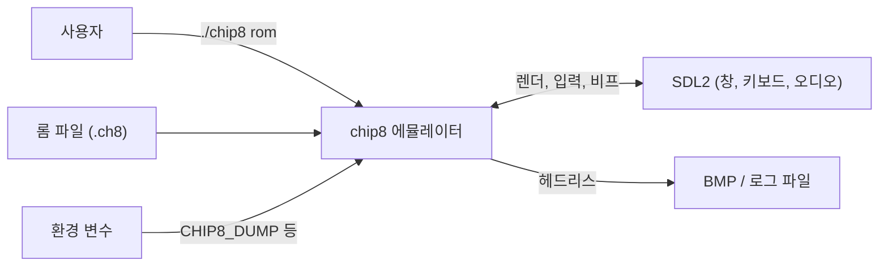

# CHIP-8 에뮬레이터 소프트웨어 요구사항 명세서 (SRS)

| 문서 | 버전 | 작성일 | 기준 표준 |
|---|---|---|---|
| CHIP-8 에뮬레이터 SRS | 1.0 | 2026-11-18 | ISO/IEC/IEEE 29148:2018 |

## 1. 소개

### 1.1 목적

이 문서는 원조 COSMAC VIP CHIP-8 에뮬레이터의 요구사항을 정의한다. 개발자, 검증자, 처음 보는 독자가 "무엇을 만족해야 하고, 무엇으로 판정하는가"를 한 문서에서 확인하는 것이 목적이다. 설계는 [SDS](SDS.md)에서 다룬다.

### 1.2 범위

`chip8`은 CHIP-8 롬(ROM, 프로그램 파일)을 읽어 실행하는 macOS용 CLI 프로그램이다.

제품이 하는 일:
- 롬을 메모리 0x200에 적재하고 원조 CHIP-8 옵코드를 VIP 의미론으로 실행
- 64x32 흑백 화면을 SDL2 창에 10배(640x320)로 표시
- 16키 키패드 입력, sound 타이머 동안 440Hz 비프음
- CPU 700 IPS, 타이머 60Hz를 서로 독립인 상수로 유지
- VIP quirk 6종을 컴파일 타임 상수로 분리
- 파일, 크기, 스택, 미지 옵코드 오류를 명시적 에러로 처리
- 창 없이 실행해 화면을 BMP로 저장하는 헤드리스 검증 모드

하지 않는 일은 [부록 B](#부록-b-범위-외-항목)에 정리한다.

### 1.3 제품 개요

#### 1.3.1 제품 관점

독립 실행형 프로그램이며 서버나 네트워크 연결이 없다. 외부와의 접점은 롬 파일, 키보드, 창, 오디오 장치, 그리고 검증용 출력 파일뿐이다.



#### 1.3.2 제품 기능

- 롬 적재와 입력 검증 (FR-1)
- 옵코드 실행 (FR-2)
- 64x32 화면 출력 (FR-3)
- 16키 입력 (FR-4)
- 60Hz 타이머와 실행 속도 제어 (FR-5)
- 비프음 (FR-6)
- VIP quirk 호환성 (FR-7)
- 헤드리스 검증 모드 (FR-8)

#### 1.3.3 사용자 특성

| 사용자 | 특성 | 사용 상황 |
|---|---|---|
| 학습자 / 개발자 | C와 CPU 기초 개념을 아는 사람 | fetch-decode-execute, 레지스터, 메모리맵, 타이머 동작을 코드로 확인 |
| 플레이어 | 터미널에서 명령 1줄을 실행할 수 있는 사람 | Pong, Tetris 같은 CHIP-8 게임을 창에서 실행 |
| 검증자 | 환경 변수와 셸 스크립트를 다루는 사람 | 테스트 롬을 헤드리스로 돌려 BMP와 로그로 판정 |

#### 1.3.4 제한 사항

| 항목 | 내용 |
|---|---|
| 언어 | C11 (`-std=c11 -Wall -Wextra -O2`) |
| 컴파일러 | clang (Makefile 기본값 `CC ?= clang`) |
| 플랫폼 | macOS만 검증 |
| 외부 의존성 | SDL2 하나 (Homebrew 설치, `pkg-config`로 플래그 획득). 링크 시 `-lm` 추가 |
| 빌드 | `make` (산출물 `chip8`), `make clean` |
| 대상 하드웨어 | 원조 COSMAC VIP CHIP-8 (메모리 4096바이트, 화면 64x32, 스택 16, 키 16) |
| 롬 | 저장소에 포함하지 않음 (`roms/`는 `.gitignore` 대상) |

### 1.4 용어 정의

| 용어 | 설명 |
|---|---|
| CHIP-8 | 1970년대 COSMAC VIP용 가상 머신. 4KB 메모리, 8비트 레지스터 16개, 64x32 흑백 화면 |
| 옵코드 (opcode) | CPU 명령 1개. CHIP-8 옵코드는 2바이트 빅엔디안 |
| fetch-decode-execute | 명령을 메모리에서 읽고(fetch), 종류를 해석하고(decode), 실행하는(execute) 한 사이클 |
| V0~VF | 8비트 범용 레지스터 16개. VF는 캐리/보로/충돌 플래그로도 쓰임 |
| I | 메모리 주소를 담는 16비트 인덱스 레지스터 |
| PC | 다음에 실행할 명령의 주소 (program counter) |
| SP | 스택에서 다음 빈 칸을 가리키는 스택 포인터 |
| 프레임버퍼 | 64x32 화면 상태를 담는 바이트 배열. 각 바이트는 0(꺼짐) 또는 1(켜짐) |
| quirk | 구현마다 다른 옵코드 세부 동작. 이 제품은 VIP 클래식 값으로 고정 |
| IPS | 초당 실행 명령 수 (instructions per second) |
| 헤드리스 | 창을 띄우지 않고 실행하는 모드. 환경 변수 `CHIP8_DUMP`로 켬 |
| busy-spin | 대기 시간 동안 sleep하지 않고 반복문으로 CPU를 계속 쓰는 것 |
| Timendus 테스트 롬 | CHIP-8 구현 검증용 공개 테스트 롬 묶음 (1-chip8-logo ~ 8-scrolling) |

## 2. 참고 문서

| 문서 | 위치 | 내용 |
|---|---|---|
| 설계 명세서 (SDS) | [SDS.md](SDS.md) | 구성, 자료구조, 시퀀스, 상태, 알고리즘 |
| README | [../README.md](../README.md) | 빌드, 실행, 키 매핑, 검증 결과 요약 |
| 프로젝트 SPEC | [../.planning/SPEC.md](../.planning/SPEC.md) | 원 요구사항 R1~R7과 검증 기록 |
| 검증 스냅샷 | [../snapshots/](../snapshots/) | 테스트 롬과 게임 실행 화면 PNG |
| Timendus chip8-test-suite | https://github.com/Timendus/chip8-test-suite | 판정 기준 테스트 롬 |
| Cowgod's Chip-8 Technical Reference | 외부 문서 | 옵코드 표 (quirk가 갈리는 지점은 VIP 값 우선) |
| Tobias Langhoff, "Guide to making a CHIP-8 emulator" | 외부 문서 | 옵코드와 quirk 설명 |

## 3. 요구사항

### 3.1 기능 요구사항

#### FR-1 실행과 롬 적재

| 설명 | 우선순위 | 출처 | 검증 방법 |
|---|---|---|---|
| `./chip8 <rom>` 실행 시 폰트셋을 0x050~0x09F에, 롬을 0x200부터 적재하고 실행을 시작해야 한다. 잘못된 입력은 명시적 에러로 종료해야 한다. | 필수 | SPEC R1 | 시험 |

수용 기준:
- 인자가 1개가 아니면 `usage: ./chip8 <rom>`을 stderr에 출력하고 종료 코드 1로 종료
- 열 수 없는 파일 경로면 `error: cannot open ROM '<path>'` 출력 후 종료 코드 2
- 3584바이트(4096 - 512) 초과 롬은 적재를 거부하고 크기와 최대값을 출력, 종료 코드 3
- 0바이트 롬은 `error: ROM '<path>' is empty` 출력 후 종료 코드 3
- 폰트셋 16글자(0~F, 글자당 5바이트)가 0x050~0x09F에 적재되고 PC는 0x200에서 시작

#### FR-2 CPU 코어 - 옵코드

| 설명 | 우선순위 | 출처 | 검증 방법 |
|---|---|---|---|
| 원조 CHIP-8 옵코드를 VIP 의미론으로 실행해야 하며, 스택은 16레벨이어야 한다. | 필수 | SPEC R2 | 시험 |

수용 기준:
- Timendus 3-corax+ 전 항목 체크 표시
- Timendus 4-flags 전 항목 체크 표시 (VF가 피연산자이면서 플래그 목적지일 때 플래그 기록이 결과 기록을 이김)
- 스택 오버플로/언더플로 시 PC를 포함한 에러 메시지를 출력하고 정지
- 미지 옵코드(SUPER-CHIP 포함)를 만나면 옵코드 값과 PC를 출력하고 정지

#### FR-3 디스플레이 - 64x32 흑백

| 설명 | 우선순위 | 출처 | 검증 방법 |
|---|---|---|---|
| DXYN은 64x32 프레임버퍼에 XOR 방식으로 그려야 하고, 렌더러는 프레임버퍼만 읽어 SDL2 창에 정수배(10배, 640x320)로 그려야 한다. | 필수 | SPEC R3 | 시험 |

수용 기준:
- Timendus 1-chip8-logo, 2-ibm-logo가 깨짐 없이 표시됨
- 00E0으로 화면 전체가 지워짐
- DXYN에서 켜진 픽셀이 꺼지는 충돌이 있으면 VF=1, 없으면 VF=0
- 시작 좌표는 64/32 모듈로로 감싸고(wrap), 스프라이트 픽셀은 화면 가장자리에서 잘림(clipping)

#### FR-4 입력 - 16키 키패드

| 설명 | 우선순위 | 출처 | 검증 방법 |
|---|---|---|---|
| COSMAC 16진 키패드를 QWERTY 왼쪽 4x4 블록(1234/QWER/ASDF/ZXCV)에 매핑하고, EX9E, EXA1, FX0A가 키패드 상태를 읽어야 한다. | 필수 | SPEC R4 | 시험, 시연 |

수용 기준:
- EX9E: 지정 키가 눌린 동안에만 다음 명령을 건너뜀
- EXA1: 지정 키가 눌리지 않은 동안에만 다음 명령을 건너뜀
- FX0A: 키를 누른 시점이 아니라 뗀 시점에 VX에 키 값을 기록
- ESC 또는 창 닫기로 언제든 종료

#### FR-5 타이머와 실행 속도

| 설명 | 우선순위 | 출처 | 검증 방법 |
|---|---|---|---|
| delay/sound 타이머는 60Hz로 1씩 감소해야 하고, CPU는 700 IPS 상수로 실행해야 하며, 두 속도는 서로 독립인 이름 붙은 상수여야 한다. | 필수 | SPEC R5 | 시험, 분석 |

수용 기준:
- 60초 실행 시 타이머 감소 횟수가 3600회 ±5% (`make CFLAGS_EXTRA=-DCHIP8_TIMER_LOG` 로그로 측정)
- IPS 상수를 바꿔도 타이머 속도가 변하지 않음
- 유휴 시 CPU 한 코어를 다 쓰지 않음 (sleep으로 프레임 페이싱)

#### FR-6 사운드 - 비프

| 설명 | 우선순위 | 출처 | 검증 방법 |
|---|---|---|---|
| sound 타이머가 0보다 큰 동안 SDL2 오디오로 비프음(440Hz 사각파)을 내야 한다. | 필수 | SPEC R6 | 시험, 시연 |

수용 기준:
- Timendus 7-beep에서 화면의 스피커 아이콘 표시 구간과 `sound_timer > 0` 구간이 프레임 단위로 일치
- SDL 오디오 출력이 440Hz 사각파이며 비프 구간과 무음 구간이 교대
- 스피커로 비프음이 들림

#### FR-7 호환성 - VIP quirk 프로파일

| 설명 | 우선순위 | 출처 | 검증 방법 |
|---|---|---|---|
| quirk 6종은 VIP 클래식 동작이어야 하고, 표준 테스트 롬과 실제 게임이 동작해야 한다. | 필수 | SPEC R7 | 시험 |

| quirk | VIP 동작 | 상수 (`chip8.h`) |
|---|---|---|
| vF reset | 8XY1/8XY2/8XY3 실행 후 VF = 0 | `QUIRK_VF_RESET` |
| memory | FX55/FX65 실행 후 I = I + X + 1 | `QUIRK_MEMORY_INCREMENT_I` |
| shifting | 8XY6/8XYE는 VY를 시프트해 VX에 저장 | `QUIRK_SHIFT_VY` |
| clipping | DXYN 스프라이트는 가장자리에서 잘림 | `QUIRK_CLIPPING` |
| display wait | DXYN은 프레임당 최대 1회 실행 | `QUIRK_DISPLAY_WAIT` |
| jumping | BNNN은 NNN + V0으로 점프 | `QUIRK_JUMP_V0` |

수용 기준:
- Timendus 5-quirks에서 CHIP-8 선택 시 6개 항목 전부 정상 판정
- Pong: 60초(3600프레임) 실행 동안 크래시 없음, 매핑 키에 패들 반응, 화면 깨짐 없음
- Tetris: 60초(3600프레임) 실행 동안 크래시 없음, 매핑 키에 블록 반응, 화면 깨짐 없음

#### FR-8 헤드리스 검증 모드

| 설명 | 우선순위 | 출처 | 검증 방법 |
|---|---|---|---|
| 환경 변수 `CHIP8_DUMP`가 설정되면 창 없이 프레임 루프를 돌린 뒤 프레임버퍼를 BMP(512x256)로 저장해야 한다. 설정하지 않으면 일반 실행과 동작이 같아야 한다. | 선택 | 코드 (`main.c`), SPEC R4/R6/R7 검증 방법 | 시험 |

수용 기준:
- `CHIP8_DUMP=<path.bmp>`로 실행하면 지정 경로에 BMP를 저장하고 종료
- `CHIP8_DUMP_KEY`, `CHIP8_DUMP_KEYSEQ`로 키 입력을 스크립트로 주입
- `CHIP8_DUMP_EVERY`로 n프레임마다 추가 BMP, `CHIP8_BEEP_LOG`로 프레임별 sound_timer 기록
- `CHIP8_SEED`로 CXNN 난수 시드를 고정해 같은 조건을 재현
- 헤드리스에서도 display wait와 프레임당 타이머 1회 감소를 일반 실행과 동일하게 적용

### 3.2 성능 요구사항

| ID | 요구사항 | 목표치 | 검증 방법 |
|---|---|---|---|
| NFR-1 | CPU 실행 속도는 상수 `CHIP8_CPU_HZ`로 정해야 한다 | 700 IPS (프레임당 `700 / 60` = 11개, 정수 나눗셈) | 분석 |
| NFR-2 | 타이머 감소와 프레임 주기는 상수 `CHIP8_TIMER_HZ`로 정해야 한다 | 60Hz, 60초에 3600회 ±5% | 시험 (`CHIP8_TIMER_LOG`) |
| NFR-3 | 메인 루프는 sleep으로 다음 프레임까지 대기해야 한다 | 유휴 시 CPU 한 코어 미만 점유 | 시험 (`top`) |

### 3.3 사용성 요구사항

- 키 매핑은 COSMAC 키패드 배치를 그대로 유지한 QWERTY 왼쪽 4x4 블록이어야 한다

| 키보드 | | | | CHIP-8 | | | |
|---|---|---|---|---|---|---|---|
| `1` | `2` | `3` | `4` | 1 | 2 | 3 | C |
| `Q` | `W` | `E` | `R` | 4 | 5 | 6 | D |
| `A` | `S` | `D` | `F` | 7 | 8 | 9 | E |
| `Z` | `X` | `C` | `V` | A | 0 | B | F |

- 모든 오류는 원인(파일 경로, 크기, 옵코드, PC)을 담은 한 줄 메시지로 stderr에 출력해야 한다
- 창 크기는 640x320 고정 (64x32의 10배 정수 스케일)

### 3.4 인터페이스 요구사항

| 구분 | 인터페이스 | 요구사항 |
|---|---|---|
| 사용자 | CLI | `./chip8 <rom>` 1개 인자. 종료 코드 0~6으로 결과 구분 |
| 사용자 | 창 | 제목 "CHIP-8", 640x320, 켜진 픽셀 흰색 / 꺼진 픽셀 검정 |
| 사용자 | 키보드 | 위 매핑의 16키 + ESC (종료) |
| 사용자 | 오디오 | 44.1kHz, S16 mono, 440Hz 사각파 |
| 사용자 | 환경 변수 | `CHIP8_DUMP`, `CHIP8_DUMP_CYCLES`, `CHIP8_DUMP_KEY`, `CHIP8_DUMP_KEYSEQ`, `CHIP8_DUMP_EVERY`, `CHIP8_BEEP_LOG`, `CHIP8_SEED` |
| 소프트웨어 | SDL2 | 비디오, 오디오, 이벤트, 서피스 / BMP 저장 API |
| 소프트웨어 | C 표준 라이브러리 | 파일 입출력, `rand`/`srand`, `getenv`, `strtol` |
| 통신 | 없음 | 네트워크 기능 없음 |

### 3.5 논리 데이터 요구사항

- 영구 저장소는 없다. 모든 에뮬레이터 상태(메모리 4096바이트, 레지스터, 스택, 타이머, 프레임버퍼, 키패드)는 프로세스 메모리에만 존재하며 종료 시 사라진다
- 롬은 읽기 전용 입력이며 수정하지 않는다
- 헤드리스 모드에서만 BMP 파일과 비프 로그 파일을 출력한다
- 상세 자료구조는 [SDS 3.4 정보 뷰](SDS.md#34-정보-뷰)에 있다

### 3.6 설계 제약

| ID | 제약 | 목표치 | 검증 방법 |
|---|---|---|---|
| NFR-4 | VIP quirk 6종을 컴파일 타임 상수로 분리하고 VIP 값으로 고정해야 한다 | Timendus 5-quirks 6/6 | 시험 |
| NFR-5 | CPU 계층은 SDL을 호출하지 않아야 하며, 화면 출력 경로는 프레임버퍼 하나여야 한다 | `chip8.c`/`chip8.h`의 SDL 호출 0건 | 검사 |
| NFR-6 | macOS + clang + Homebrew SDL2 환경에서 빌드되어야 한다 | `make` 한 번으로 빌드 | 시연 |

### 3.7 소프트웨어 시스템 속성

| ID | 속성 | 요구사항 | 목표치 | 검증 방법 |
|---|---|---|---|---|
| NFR-7 | 보안 | 모든 메모리 인덱스를 4KB 안으로 마스킹해야 한다 (`addr & 0x0FFF`) | I/PC 이탈 시 프로세스 메모리 침범 0건 | 시험 (수제 롬) |
| NFR-8 | 신뢰성 | 오디오 장치를 못 열어도 경고만 출력하고 무음으로 계속 실행해야 한다 | 오디오 실패로 인한 종료 0건 | 검사 |
| NFR-9 | 유지보수성 | 검증용 훅은 환경 변수/컴파일 플래그로만 켜져야 한다 | 미설정 시 일반 실행 동작 변화 없음 | 검사 |

이식성은 macOS만 보장한다 (3.6의 NFR-6). 가용성은 단일 사용자 로컬 프로그램이라 해당하지 않는다.

### 3.8 금지 조건 (must-NOT)

- I 또는 PC가 4KB 범위를 벗어나도 에뮬레이터 프로세스 메모리를 침범하지 않는다 (마스킹으로 방어)
- SUPER-CHIP 옵코드를 조용히 구현하거나 조용히 무시하지 않는다 (미지 옵코드 경로로 정지)
- 화면에 그리는 유일한 경로는 64x32 프레임버퍼다 (옵코드가 SDL을 직접 호출하지 않음)
- 메인 루프가 sleep/페이싱 없이 CPU를 태우지 않는다

## 4. 검증

### 4.1 검증 방법

별도 단위 테스트 프레임워크는 없다. 테스트 롬을 헤드리스 모드로 실행하고 화면을 스냅샷으로 남겨 판정한다.

| 계층 | 대상 | 방법 | 근거 |
|---|---|---|---|
| 옵코드 정확성 | 3-corax+, 4-flags | 헤드리스 실행 후 화면에서 전 항목 체크 확인 | `snapshots/3-corax+.png`, `snapshots/4-flags.png` |
| 화면 출력 | 1-chip8-logo, 2-ibm-logo | 헤드리스 BMP | `snapshots/1-chip8-logo.png`, `snapshots/2-ibm-logo.png` |
| quirk | 5-quirks (CHIP-8 선택) | `CHIP8_DUMP_KEY`로 메뉴 키 주입 | `snapshots/5-quirks.png` |
| 키패드 | 6-keypad의 EX9E, EXA1, FX0A | `CHIP8_DUMP_KEYSEQ`로 프레임 단위 누름/뗌 주입, held/released 화면 비교 | `snapshots/6-keypad-*.png` |
| 사운드 | 7-beep | `CHIP8_BEEP_LOG` 프레임 트레이스 + `SDL_AUDIODRIVER=disk`로 실제 오디오 출력 캡처 | `.planning/SPEC.md` R6 기록 |
| 게임 | Pong, Tetris | 3600프레임 헤드리스 실행, `CHIP8_SEED` 고정 후 무입력 런과 키 주입 런 비교 | `snapshots/pong-*.png`, `snapshots/tetris-*.png` |
| 타이밍 | 타이머 60Hz | `CHIP8_TIMER_LOG` 빌드로 실창 실행 후 Hz 확인 | 기록 없음 |
| 실창 전용 | ESC 종료, 가청 여부, 실시간 플레이감 | 창 모드 수동 실행 | 기록 없음 |

실행 예시:

```sh
make

# 옵코드 테스트 화면을 BMP로 저장
CHIP8_DUMP=out.bmp ./chip8 roms/3-corax+.ch8

# 키 5를 프레임 60에 누르고 70에 뗌
CHIP8_DUMP=out.bmp CHIP8_DUMP_KEYSEQ="60:5:d,70:5:u" ./chip8 roms/6-keypad.ch8

# 비프 프레임 트레이스와 실제 오디오 출력 캡처 (S16 mono 44.1kHz)
CHIP8_DUMP=out.bmp CHIP8_BEEP_LOG=beep.log ./chip8 roms/7-beep.ch8
SDL_VIDEODRIVER=dummy SDL_AUDIODRIVER=disk SDL_DISKAUDIOFILE=out.raw ./chip8 roms/7-beep.ch8

# 타이머 주기 측정 빌드
make clean
make CFLAGS_EXTRA=-DCHIP8_TIMER_LOG
```

### 4.2 요구사항 추적표

판정 근거가 저장소에 있는 항목만 충족으로 표시한다. 실창 실행, 수제 롬, `top` 측정처럼 기록이 저장소에 남지 않은 항목은 미검증이다.

| ID | 요구사항 | 구현 위치 | 검증 근거 | 상태 |
|---|---|---|---|---|
| FR-1 | 인자 없으면 usage, 종료 코드 1 | `main.c` (`usage`, `main`) | 기록 없음 | 미검증 |
| FR-1 | 파일 없음 에러, 종료 코드 2 | `chip8.c` (`chip8_load_rom`) | 기록 없음 | 미검증 |
| FR-1 | 3584바이트 초과 / 빈 롬 거부, 종료 코드 3 | `chip8.c` (`chip8_load_rom`) | 기록 없음 | 미검증 |
| FR-1 | 폰트셋 0x050~0x09F 적재, PC=0x200 | `chip8.c` (`chip8_init`) | 기록 없음 | 미검증 |
| FR-2 | 3-corax+ 전 항목 체크 | `chip8.c` (`chip8_cycle`) | `snapshots/3-corax+.png` | 충족 |
| FR-2 | 4-flags 전 항목 체크 | `chip8.c` (`chip8_cycle`, 8XYN) | `snapshots/4-flags.png` | 충족 |
| FR-2 | 스택 오버/언더플로 시 PC 출력 후 정지 | `chip8.c` (`stack_push`, `stack_pop`) | 기록 없음 | 미검증 |
| FR-2 | 미지 옵코드 시 옵코드와 PC 출력 후 정지 | `chip8.c` (`unknown_opcode`) | 기록 없음 | 미검증 |
| FR-3 | 1-chip8-logo, 2-ibm-logo 정상 표시 | `chip8.c` (`op_draw`), `platform.c` | `snapshots/1-chip8-logo.png`, `snapshots/2-ibm-logo.png` | 충족 |
| FR-3 | 00E0 화면 지우기 | `chip8.c` (`chip8_cycle`) | 기록 없음 | 미검증 |
| FR-3 | DXYN 충돌 시 VF=1 | `chip8.c` (`op_draw`) | `snapshots/3-corax+.png` | 충족 |
| FR-3 | 좌표 wrap, 픽셀 clipping | `chip8.c` (`op_draw`) | `snapshots/5-quirks.png` (clipping 항목) | 충족 |
| FR-4 | EX9E | `chip8.c`, `platform.c` (`platform_poll_input`) | `snapshots/6-keypad-ex9e-held.png`, `snapshots/6-keypad-ex9e-released.png` | 충족 |
| FR-4 | EXA1 | `chip8.c`, `platform.c` | `snapshots/6-keypad-exa1-held.png`, `snapshots/6-keypad-exa1-released.png` | 충족 |
| FR-4 | FX0A 릴리스 시점 등록 | `chip8.c` (FX0A, `fx0a_key`) | `snapshots/6-keypad-fx0a-held.png`, `snapshots/6-keypad-fx0a-allgood.png` | 충족 |
| FR-4 | ESC / 창 닫기로 종료 | `platform.c` (`platform_poll_input`) | 실창 실행 필요, 기록 없음 | 미검증 |
| FR-5 | 60초에 타이머 3600회 ±5% | `main.c` (메인 루프, `CHIP8_TIMER_LOG`) | 측정 기록 없음 | 미검증 |
| FR-5 | IPS 변경 시 타이머 속도 불변 | `main.c` (`CHIP8_CPU_HZ`, `CHIP8_TIMER_HZ`) | 측정 기록 없음 | 미검증 |
| FR-5 | busy-spin 없음 | `main.c` (`platform_delay_ms`) | `top` 측정 기록 없음 | 미검증 |
| FR-6 | 7-beep 표시와 sound_timer 프레임 동기, 440Hz 사각파 출력 | `main.c`, `platform.c` (`audio_callback`) | `.planning/SPEC.md` R6 측정 기록 (로그 파일은 저장소에 없음) | 충족 |
| FR-6 | 스피커로 들림 | `platform.c` | 스피커 확인 기록 없음 | 미검증 |
| FR-7 | 5-quirks 6개 항목 정상 | `chip8.h` (`QUIRK_*`), `chip8.c`, `main.c` | `snapshots/5-quirks.png` | 충족 |
| FR-7 | Pong 60초 무크래시, 키 반응 | 전체 | `snapshots/pong.png`, `snapshots/pong-60s-final.png`, `snapshots/pong-keyresponse.png` | 충족 |
| FR-7 | Tetris 60초 무크래시, 키 반응 | 전체 | `snapshots/tetris.png`, `snapshots/tetris-60s-final.png`, `snapshots/tetris-keyresponse.png` | 충족 |
| FR-8 | 헤드리스 덤프, 키 주입, 비프 로그, 시드 고정 | `main.c` (`run_headless`, `parse_keyseq`), `platform.c` (`platform_dump_bmp`) | `snapshots/` 전체가 이 모드로 생성 (`.planning/SPEC.md` R4, R6, R7 기록) | 충족 |
| NFR-1 | 700 IPS 상수 | `main.c` (`CHIP8_CPU_HZ`) | 측정 기록 없음 | 미검증 |
| NFR-2 | 타이머 60Hz | `main.c` (`CHIP8_TIMER_HZ`) | 측정 기록 없음 | 미검증 |
| NFR-3 | sleep 페이싱 | `main.c` | `top` 측정 기록 없음 | 미검증 |
| NFR-4 | quirk 컴파일 타임 상수 | `chip8.h` | `snapshots/5-quirks.png` | 충족 |
| NFR-5 | CPU 계층 SDL 호출 0건 | `chip8.c`, `chip8.h` | 두 파일에 `SDL` 문자열은 주석 3줄뿐, `#include <SDL.h>`와 `SDL_` 호출 없음 | 충족 |
| NFR-6 | macOS + clang + SDL2 빌드 | `Makefile` | 기록 없음 | 미검증 |
| NFR-7 | 메모리 4KB 마스킹 | `chip8.c` (`mem_addr`) | 수제 롬 기록 없음 | 미검증 |
| NFR-8 | 오디오 실패 비치명 | `platform.c` (`platform_create`) | 기록 없음 | 미검증 |
| NFR-9 | 검증 훅 기본 꺼짐 | `main.c`, `Makefile` (`CFLAGS_EXTRA`) | 기록 없음 | 미검증 |

## 부록 A. 가정과 의존성

- 실행 환경에 Homebrew SDL2와 `pkg-config`가 설치되어 있다
- 롬 파일은 사용자가 직접 `roms/`에 배치한다. 테스트 롬은 Timendus chip8-test-suite의 `bin/`에서, Pong/Tetris는 퍼블릭 도메인 CHIP-8 롬 아카이브에서 구한다
- 판정은 Timendus 테스트 롬의 화면 표시(체크 표시)가 정확하다는 전제를 따른다
- CXNN 난수는 C 표준 `rand()`를 사용하며 시드는 기본적으로 시작 시각이다

## 부록 B. 범위 외 항목

| 항목 | 이유 |
|---|---|
| SUPER-CHIP / XO-CHIP 확장 | 옵코드와 해상도가 달라 별개 프로젝트 분량 |
| 런타임 quirk 토글 (CLI 옵션, 설정 파일) | 학습 목적에는 컴파일 타임 상수로 충분 |
| 디버거 / 디스어셈블러 UI | 범위 대비 분량 초과. printf 디버깅으로 충분 |
| 세이브 스테이트 / 되감기 | 학습 목표(CPU 사이클)와 무관 |
| Windows / Linux 패키징 | macOS 빌드만 보장. 이식 불가능할 이유는 없지만 검증 안 함 |
| 사운드 파형 / 볼륨 옵션 | 가청 여부만이 목표 |
| FX1E의 VF 변경 (Amiga quirk) | 목표 롬 어느 것도 사용하지 않음 |
